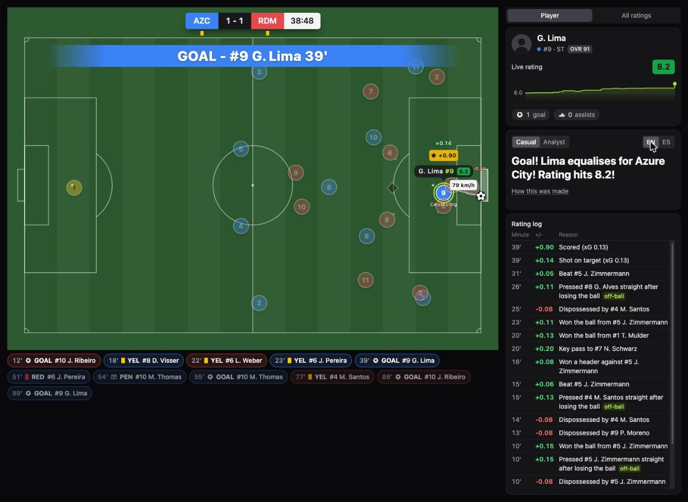

# Player Lens

A live 2D synthetic football match where you follow one player: a personal AI commentator and a self-explaining rating that credits off-ball work. Built for the Microsoft x Premier League "Inside the Game" developer hackathon (category: Best Multi-Agent System).

**Live demo:** https://player-lens.wittysea-a332ed57.eastus.azurecontainerapps.io (click Start match; the hero match follows G. Lima, #9 Azure City)



All clubs and players are fictional (Atlas League: Azure City vs Redmond United), and all match data is synthetic.

## The pitch

Football is watched through the ball, so most of what a player does is invisible. Player Lens follows one player instead. Click any of the 22 players and a personal commentator talks about him, while his rating moves with every action and explains itself, including the off-ball work normal stats ignore: a counterpress right after losing the ball, a recovery run, a decoy run that opens space for a teammate. Code computes every number; six AI agents only write the words, and a validator checks every line against the event log before it is spoken.

## Features

- **Follow any player** in a live 2D match (1x to 30x, seek, full screen, keyboard play): spotlight, movement arrows, rating pills, highlights row (goals, cards, penalties).
- **A rating that explains itself:** starts at 6.0 and moves with every action; each change has a reason in the rating log ("Pressed Zimmermann straight after losing the ball +0.15"), and a click replays the moment. Off-ball work counts.
- **A personal AI commentator** that speaks: about one line every 22 seconds, every rating change commented (good or bad), the play around him in quiet spells, a hyped home-team voice that rises near goal and carries the mood after a goal.
- **Casual or Analyst, English or Mexican Spanish**, switchable at any moment.
- **"How this was made"** under every line: the six agent steps that wrote it, and any Fact Guard catch with the before and after.
- **Any player, live:** the star's match is pre-generated; any other player's commentary is generated by the agents the first time someone watches that minute, then cached for everyone, under an all-time spend cap.
- **Full-time recap** per player, spoken. A home crowd (real stadium recordings, CC0) that reacts to goals, chances and cards.

## Tech stack

| Layer | Built with |
| --- | --- |
| Simulator and rating engine | Python, numpy, Pydantic contracts; seeded and deterministic (same seed, byte-identical match files) |
| Agents | Microsoft Agent Framework: Interpreter, Moments, Commentator, Fact Guard, Personalizer, Voice Director, chained with `WorkflowBuilder`, every handoff schema-validated |
| Model | GPT-4.1 mini on Microsoft Foundry |
| Voice | Azure AI Speech, HD Omni voices with 14 emotion styles |
| Backend | FastAPI, plain JSON and MP3 files as the cache (no database) |
| Frontend | React, Vite, Tailwind, SVG pitch, Web Audio |
| Hosting | Docker on Azure Container Apps, Azure Container Registry, Azure Files for the generated-commentary cache |

Status: Phase 1 (match data), Phase 2 (match viewer, `web/`), Phase 3 (the six-agent commentary pipeline, FastAPI backend, Azure Speech voice) and Phase 4 (Docker image, deployed on Azure Container Apps) built. Without keys the app plays the full match with template commentary; Lima's hero commentary and voice are pre-generated and ship with the repo; with keys the commentary for any other player is written live by the agents and cached. Hackathon rules: see the official rules on the event site. See `PRODUCT.md`, `ARCHITECTURE.md`, `TASKS.md`, and `specs/`.

## Quick start

```bash
python -m venv .venv && source .venv/bin/activate
pip install -r requirements.txt
cp .env.example .env   # fill in keys; never commit .env
pytest
```

## Run the backend and the commentary agents (Phase 3)

Microsoft Agent Framework runs six agents per one-minute chunk (Interpreter, Moments, Commentator, Fact Guard, Personalizer, Voice Director) on a Foundry-hosted model, then Azure AI Speech voices the lines. Code computes every number; the model only writes words. Without keys everything still works on template lines.

```bash
source .venv/bin/activate
uvicorn app.main:app --port 8000        # API + (after `npm run build` in web/) the built app; start before `npm run dev`
python scripts/spend.py                 # what live Azure calls have cost so far (data/spend_ledger.jsonl)
python scripts/pregenerate.py --chunks 38,88 --dry-run   # offline pre-generation of the hero match for azc_09 (see its docstring)
```

Fill `.env` from `.env.example`: `AZURE_OPENAI_ENDPOINT`, `AZURE_OPENAI_API_KEY`, `AZURE_OPENAI_DEPLOYMENT`, the two `LLM_PRICE_*` values, `AZURE_SPEECH_KEY`, `AZURE_SPEECH_REGION` and the four `SPEECH_VOICE_*` names. `LIVE_CAP_USD=0` (the default) means visitors never trigger live generation; above 0 it is an all-time dollar cap on model and voice spend. `PERSIST_DIR` (default `data/`) is where the on-demand cache and the spend ledger go; in production it is an Azure Files share (specs/deployment.md, "Persistent cache"). Tests use a fake model and fake Speech: no test ever calls Azure.

| Piece | Code |
| --- | --- |
| Facts, cadence schedule (code-built, deterministic) | `agents/inputs.py`, knobs in `agents/config.py` |
| The six-agent workflow (Agent Framework) and prompts | `agents/pipeline.py`, `agents/prompts/*.md` |
| Fact Guard validator, template fallback | `agents/fact_guard.py`, `agents/templates.py` |
| Model client, Speech, recap | `agents/llm.py`, `agents/speech.py`, `agents/recap.py` |
| FastAPI app, settings, file cache, spend ledger and caps | `app/main.py`, `app/settings.py`, `app/cache.py`, `app/budget.py` |
| Offline pre-generation and spend report | `scripts/pregenerate.py`, `scripts/spend.py` |

## Generate the match data (code only, no LLM calls)

Everything is seeded and deterministic: the same seed gives byte-identical files.

```bash
python scripts/export_schemas.py      # Pydantic models -> contracts/*.schema.json
python -m sim.roster                  # both squads -> data/world.json
python -m sim.run --library           # the 3 library matches (+ the backup hero) -> data/matches/<match_id>/{meta,events,ratings,positions}.json
python -m sim.run --seed 123 --match-id test   # any other seed (validation only)
python scripts/calibrate.py --seeds 200 --report docs/validation-report.md   # benchmark check
python scripts/find_seeds.py --seeds 4000      # how the library seeds were found
```

Every match file is validated against its contract and the cross-file checks in `specs/match-files.md` before it is written.

| Piece | Code |
| --- | --- |
| Data models and contracts | `sim/models.py`, `agents/models.py`, `contracts/` |
| Roster generator | `sim/roster.py`, `sim/names.py`, `sim/blocklist.txt` |
| Simulator (movement, decisions, rules, engine) | `sim/movement.py`, `sim/possession.py`, `sim/rules.py`, `sim/engine.py`, knobs in `sim/config.py` |
| Off-ball detection and rating engine | `rating/offball.py`, `rating/engine.py`, knobs in `rating/config.py` |
| Match files and validation | `sim/pipeline.py`, `sim/validate.py`, `sim/run.py`, `sim/library.py` |
| Calibration | `scripts/calibrate.py`, `docs/validation-report.md` |
| Dev match viewer (not the product UI) | `scripts/viewer.html`: run `python -m http.server 8000`, open http://localhost:8000/scripts/viewer.html |

## Run the match viewer (web/)

React + Vite + Tailwind + TypeScript. Needs Node 20+ (the dev machine uses `source ~/.nvm/nvm.sh && nvm use 22`). The dev server proxies `/matches`, `/data`, `/commentary`, `/agents`, `/recap` and the commentary audio to FastAPI on port 8000 (the crowd clips under `/audio/crowd/` are static files); nothing is copied into `web/`.

```bash
cd web
npm install
npm run dev          # http://localhost:5173 (opens on the hero match with a Start overlay)
npm test             # unit tests for the pure helpers (formatters, reason templates, lookups, template commentary)
npm run build        # typecheck + production build into web/dist (served by FastAPI from Phase 4)
npm run gen:types    # regenerate src/types/generated/ after contracts/*.schema.json change
```

Keyboard: Space plays or pauses (and starts from the overlay), Enter starts, left and right arrows seek 5 s.

| Piece | Code |
| --- | --- |
| Data loading and lookups | `web/src/lib/match.ts` |
| Playback clock | `web/src/lib/clock.ts`, `web/src/hooks/useClock.ts` |
| Rating reason templates (EN/ES) | `web/src/lib/reasons.ts` |
| Commentary from the backend (`getCommentaryChunk`, `getTrace`, `getRecap`) and the offline template fallback | `web/src/lib/commentary.ts` |
| Crowd and commentary voice (one master gain, no ducking, a voice queue) | `web/src/lib/audio.ts` |
| Frontend knobs | `web/src/lib/config.ts` |
| Components (pitch, panels, overlays) | `web/src/components/` |
| "How this was made" trace view | `web/src/components/AgentTrace.tsx` |

## Deploy (Phase 4)

One Docker image (the built web app, the FastAPI backend, the match files and the pre-generated hero commentary and audio) runs on Azure Container Apps; the image lives in Azure Container Registry, and generated commentary is kept on an Azure Files share mounted at `/mnt/persist` (`PERSIST_DIR`). Full details, costs and the one-time Azure setup: `specs/deployment.md`.

```bash
docker build --platform linux/amd64 -t player-lens .       # Apple Silicon needs the platform flag
docker run --platform linux/amd64 -p 8001:8000 player-lens # http://localhost:8001, template lines without keys
az login && az extension add --name containerapp --upgrade # once
python scripts/deploy.py --dry-run                         # print every step, change nothing
python scripts/deploy.py                                   # build, push, deploy (keeps the app's LIVE_CAP_USD)
python scripts/deploy.py --live-cap 130                    # set the all-time live spend cap (0 turns live AI off)
python scripts/deploy.py --skip-build --image-tag <tag>    # roll back to an image already in the registry
```

The keys come from `.env` and are stored as Container Apps secrets; they never enter the image or the output.
